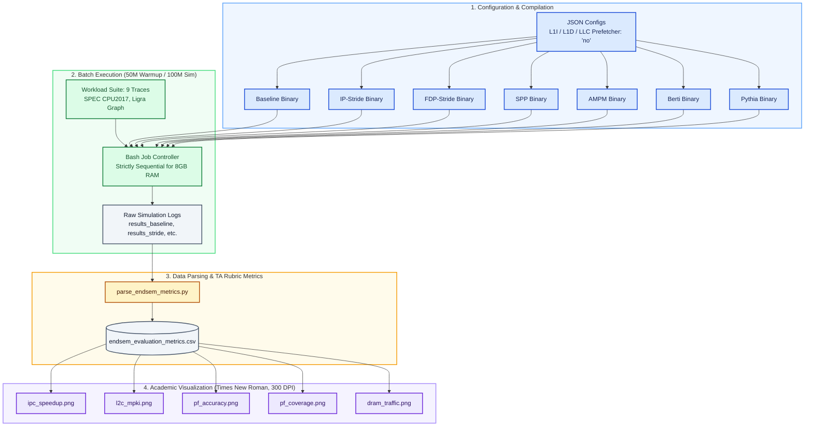

# ChampSim L2 Cache Prefetcher Evaluation

This repository contains the experimental pipeline, configuration files, and analysis scripts used to evaluate L2 cache prefetchers in ChampSim. The study compares a no-prefetch baseline against six L2 prefetcher designs—IP-Stride, Feedback-Directed Stride (FDP-Stride), Signature Path Prefetcher (SPP), Access Map Pattern Matching (AMPM), Berti, and Pythia—across SPEC CPU2017 and Ligra graph analytics workloads.

## Project Overview

- **Simulator:** ChampSim
- **Workloads:** SPEC CPU2017 (`603.bwaves`, `605.mcf`, `619.lbm`, `620.omnetpp`, `623.xalancbmk`, `649.fotonik3d`) and Ligra graph kernels (`ligra_BFSCC`, `ligra_PageRankDelta`, `ligra_Triangle`)
- **Simulation length:** 50M warmup instructions, 100M simulated instructions
- **Hardware target:** macOS on Apple Silicon with 8 GB unified memory (sequential execution required for heavy traces)
- **L1D / LLC prefetching:** Disabled (`"no"`) across all configurations to strictly isolate L2 cache prefetcher behavior

---

## Experimental Workflow



---

## 1. Environment Setup

ChampSim depends on the native macOS `clang++` / `g++` toolchain. If you are using Miniconda or Anaconda, avoid using the Conda-provided C++ compiler because it triggers header failures related to `from_chars_floating_point.h`. Additionally, ensure the Xcode Command Line Tools license is accepted if macOS recently updated Xcode.

Before building the simulator, run:

```bash
conda deactivate
sudo xcodebuild -license accept
make clean
python3 -m venv venv
source venv/bin/activate
pip install pandas matplotlib numpy
```

## 2. Build the Simulator

The project includes seven prefetcher configurations, each defined by a JSON config and built into a separate binary in the `bin/` directory.

### 2.1 Baseline (No Prefetching)

```bash
./config.sh baseline_config.json && make
```

### 2.2 AMPM Prefetcher

```bash
./config.sh ampm_config.json && make
```

### 2.3 Stride Prefetcher (`ip_stride`)

```bash
./config.sh stride_config.json && make
```

### 2.4 Feedback-Directed Stride (`improved_stride`)

```bash
./config.sh improved_stride_config.json && make
```

### 2.5 SPP Prefetcher (`spp_dev`)

Before compiling SPP, bypass its table-full assertion:

```bash
perl -pi -e 's/assert\(0\);/\/\/ bypassed assert/g' prefetcher/spp_dev/spp_dev.cc
./config.sh spp_dev_config.json && make
```

### 2.6 Berti Prefetcher

```bash
./config.sh berti_config.json && make
```

### 2.7 Pythia Prefetcher

```bash
./config.sh pythia_config.json && make
```

All successful builds are stored under the `bin/` directory.

## 3. Run Simulations

To avoid memory pressure and excessive swapping on an 8 GB host, execute the provided shell scripts sequentially. In particular, `603.bwaves` and `605.mcf` can consume more than 2.5 GB RAM each; running jobs in parallel can trigger macOS memory pressure failures (`Abort trap: 6`).

Make the scripts executable:

```bash
chmod +x run_*.sh
```

Run each batch sequentially:

```bash
./run_baseline.sh
./run_ampm.sh
./run_stride.sh
./run_improved_stride.sh
./run_spp.sh
./run_berti.sh
./run_pythia.sh
```

Simulation outputs are written to their respective `results_<config>/` directories.

## 4. Extract Results & Compute Metrics

After the simulation runs finish, extract the raw ChampSim output into a structured CSV summary:

```bash
python3 parse_endsem_metrics.py
```

This generates `endsem_evaluation_metrics.csv` using the following metric definitions:

- **Baseline L2C MPKI:** `(L2 demand misses / instructions) * 1000`
- **Coverage:** `(Misses in no prefetch - Misses with prefetch) / Misses in no prefetch`
- **Accuracy:** `Useful Prefetches / Prefetch fill`
- **IPC Speedup:** `IPC_prefetch / IPC_baseline`
- **Memory Traffic:** Extracted directly from `LLC TOTAL MISS` as a 1:1 proxy for DRAM accesses in this single-core topology

## 5. Generate Visualizations

The repository includes plotting scripts built with `pandas` and `matplotlib` (configured with **Times New Roman** academic styling). These scripts save high-resolution figures at 300 DPI.

Run the visualization suite:

```bash
python3 plot_ipc.py
python3 plot_acc_cov.py
python3 plot_dram.py
python3 plot_mpki.py
```

The generated charts are saved in the `plots/` directory:

- `ipc_speedup.png`
- `l2c_mpki.png`
- `pf_accuracy.png`
- `pf_coverage.png`
- `dram_traffic.png`

## 6. Memory Access Characterization

To explain why each prefetcher succeeds or fails on specific workloads, the baseline L2 prefetcher hook (`prefetcher/no/no.cc`) is instrumented to dump a bounded post-warmup sample of 50,000 L2 demand load accesses (`AccessOrder, LoadPC, CacheLineAddr, Hit`).

The `analyze_accesses.py` script processes these samples to compute:

1. **PC-Local Delta Behavior:** Top L2-missing load PCs, their most frequent address stride, and dominant-delta fraction.
2. **Ordered Delta History:** Top recurring 4-step within-page delta sequences.
3. **Spatial Footprints:** 4-KB page cache-line density (`Unique Offsets / 64`) and repeating page bitmaps.

Run the characterization analysis on the collected samples:

```bash
python3 analyze_accesses.py sample_fotonik3d.csv
python3 analyze_accesses.py sample_bfscc.csv
python3 analyze_accesses.py sample_xalancbmk.csv
```

## 7. Expected Anomalies and Edge Cases

- **SPP Internal Assertion:** Apply the SPP patch in Section 2.5 before running heavy workloads.
- **Memory Pressure:** Incomplete runs under host memory limits should be rerun sequentially and checked before plotting.

## 8. Quick Start

To reproduce the full workflow in order:

```bash
conda deactivate
make clean
python3 -m venv venv
source venv/bin/activate
pip install pandas matplotlib numpy
perl -pi -e 's/assert\(0\);/\/\/ bypassed assert/g' prefetcher/spp_dev/spp_dev.cc

for config in baseline_config.json ampm_config.json stride_config.json improved_stride_config.json spp_dev_config.json berti_config.json pythia_config.json; do
    ./config.sh "$config" && make
done

chmod +x run_*.sh
for script in run_baseline.sh run_ampm.sh run_stride.sh run_improved_stride.sh run_spp.sh run_berti.sh run_pythia.sh; do
    ./"$script"
done

python3 parse_endsem_metrics.py
python3 plot_ipc.py
python3 plot_acc_cov.py
python3 plot_dram.py
python3 plot_mpki.py
python3 analyze_accesses.py sample_fotonik3d.csv
python3 analyze_accesses.py sample_bfscc.csv
python3 analyze_accesses.py sample_xalancbmk.csv
```
